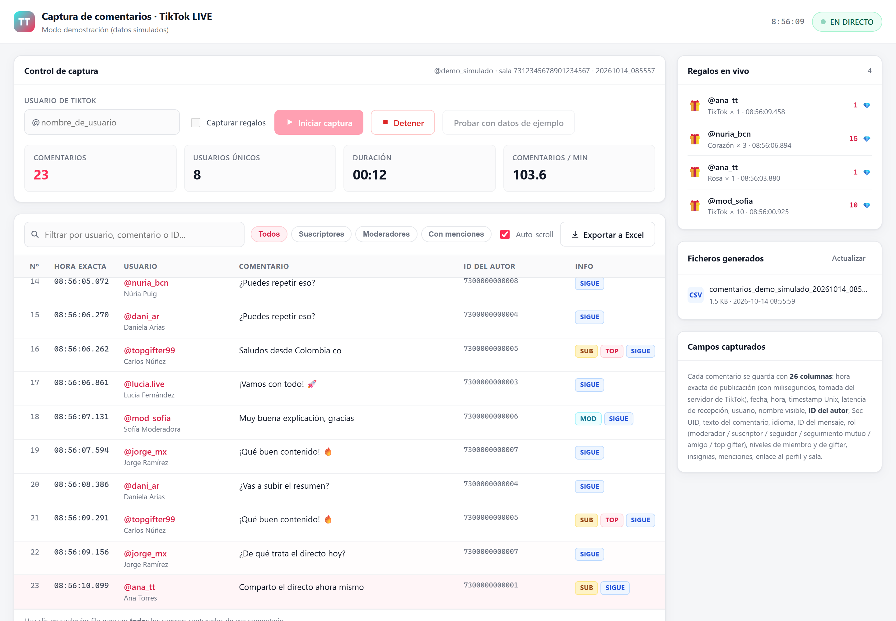
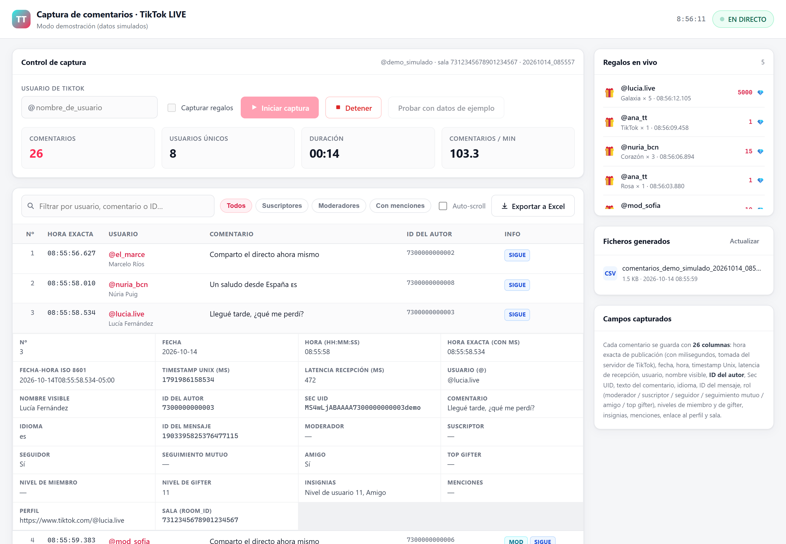
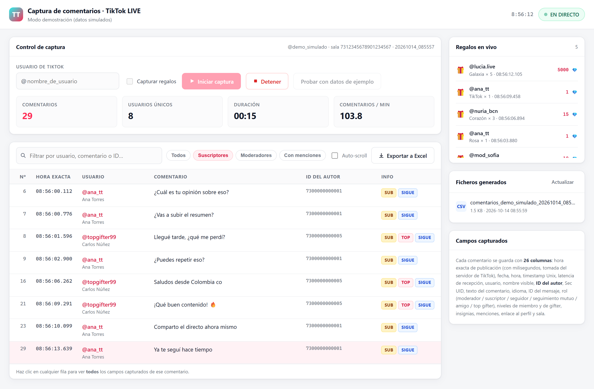

<div align="center">

# 💬 TikTok LIVE Comment Capture

**Real-time comment capture for TikTok LIVE streams.**
Exact publish time, author identity and role for every message — exported to Excel with one field per column.

[](https://www.python.org/)
[](https://flask.palletsprojects.com/)
[](#-requirements)
[](LICENSE)



</div>

> ⚠️ **TikTok does not store the chat of a live stream.** If you don't capture it while the stream is running, it's gone forever. That's the whole reason this tool exists.

---

## 📖 Table of contents

- [🎯 What it does](#-what-it-does)
- [✨ Features](#-features)
- [📸 Screenshots](#-screenshots)
- [📊 What gets captured](#-what-gets-captured)
- [✅ Requirements](#-requirements)
- [🚀 Quick start](#-quick-start)
- [🧪 Trying it without a live stream](#-trying-it-without-a-live-stream)
- [💻 Command line usage](#-command-line-usage)
- [📁 Output files](#-output-files)
- [🏗️ How it works](#️-how-it-works)
- [🔍 Verification](#-verification)
- [⚠️ Limitations and legal notes](#️-limitations-and-legal-notes)
- [📄 License](#-license)

---

## 🎯 What it does

You give it a TikTok username that is currently live. It connects to the stream, listens for comments and records every single one with the **exact moment it was published according to TikTok's servers**, who wrote it and what their standing is in the room.

It's aimed at anyone who needs to analyse what was said in a live stream: audience research, moderation, sentiment analysis, spotting frequently asked questions, or simply keeping a record of a conversation that TikTok throws away.

Everything runs locally on your machine. There is no server, no account and no API key.

---

## ✨ Features

| | |
|---|---|
| 🔴 **Live capture** | Comments appear on screen as they arrive, streamed over Server-Sent Events. No refreshing, no polling. |
| ⏱️ **Exact timestamps** | Publish time taken from TikTok's own server with millisecond precision, plus the **reception latency** computed for every message. |
| 👤 **Author identity** | Username, display name, numeric ID, Sec UID and a direct link to the profile. |
| 🏅 **Role and context** | Moderator, subscriber, follower, mutual follow, friend, top gifter, member level, gifter level and badges. |
| 💾 **Nothing gets lost** | The CSV is written row by row with `flush()`, so a crash or a `Ctrl+C` doesn't take the session with it. |
| 📊 **Automatic Excel** | The workbook is generated when the capture stops — four sheets, formatted and ready to filter. |
| 🧹 **Real deduplication** | Messages are deduplicated by their actual `msg_id`, never by text: people deliberately repeat themselves in chat. |
| 🔎 **Filterable interface** | Free-text search, filters for subscribers / moderators / mentions, and a detail panel showing all 26 fields of any comment. |
| 🧪 **Demo mode** | Generates synthetic comments so you can try the whole thing without waiting for someone to go live. |
| 🖱️ **Double-click launcher** | `INICIAR.bat` sets up the environment the first time and opens the browser by itself. |
| ⌨️ **Console mode** | For long sessions where you'd rather not keep a browser open. |

---

## 📸 Screenshots

**Every field of a single comment.** Click any row to expand it into the full set of 26 captured fields — the raw server timestamp, the Sec UID, the badge list, the mention list, everything.



**Filters and the side panel.** Filter down to subscribers, moderators or comments containing mentions, while the side panel keeps the live gift feed and every file generated so far.



> 🗣️ **A note on language:** the interface and the Excel headers are in Spanish, because that's the language this project was built in. The column names are documented below in English. If you'd like an English UI, it's a contained change — the strings live in `templates/index.html`, `static/app.js` and the column definitions at the top of `capturer.py`.

---

## 📊 What gets captured

**26 fields per comment.** These are the exact headers you'll find in both the Excel and the CSV:

| # | Column | Contents |
|:--:|---|---|
| 1 | `Nº` | Sequential index within the session |
| 2 | `Fecha` | Publish date (`YYYY-MM-DD`) |
| 3 | `Hora (HH:MM:SS)` | Publish time |
| 4 | `Hora exacta (con ms)` | Publish time with milliseconds |
| 5 | `Fecha-hora ISO 8601` | Full timestamp including timezone |
| 6 | `Timestamp Unix (ms)` | Millisecond epoch timestamp |
| 7 | `Latencia recepción (ms)` | Delay between publication and reception |
| 8 | `Usuario (@)` | Username (`@handle`) |
| 9 | `Nombre visible` | Display name shown in the stream |
| 10 | `ID del autor` | Numeric user identifier |
| 11 | `Sec UID` | Stable internal account identifier |
| 12 | `Comentario` | The message text |
| 13 | `Idioma` | Detected language of the comment |
| 14 | `ID del mensaje` | Unique message identifier (used for deduplication) |
| 15 | `Moderador` | `Sí` if they moderate the stream |
| 16 | `Suscriptor` | `Sí` if they subscribe to the channel |
| 17 | `Seguidor` | `Sí` if they follow the creator |
| 18 | `Seguimiento mutuo` | `Sí` if the follow is mutual |
| 19 | `Amigo` | `Sí` if they hold the friend badge |
| 20 | `Top gifter` | `Sí` if they're on the gift leaderboard |
| 21 | `Nivel de miembro` | Fans club level |
| 22 | `Nivel de gifter` | User level earned by sending gifts |
| 23 | `Insignias` | Every badge they hold, with its level |
| 24 | `Menciones` | Users mentioned with `@` |
| 25 | `Perfil` | Link to the TikTok profile |
| 26 | `Sala (room_id)` | Identifier of the live room |

Columns 2 to 6 are different representations of **the same instant**: the publish time reported by TikTok's server. If the server doesn't send it, the local reception time is used instead.

---

## ✅ Requirements

- 🐍 **Python 3.10 or newer** (developed and tested on 3.13)
- 🪟 Windows for the `.bat` launcher — on Linux and macOS you start it manually
- 🌐 An internet connection
- ❌ No GPU, no API key, no TikTok account

---

## 🚀 Quick start

**1. Double-click `INICIAR.bat`.**

The first run creates the virtual environment and installs the dependencies (about a minute). Every run after that starts straight away. The browser opens on its own at `http://127.0.0.1:5000`.

**2. Type the username** of a TikTok account that is currently live (with or without the `@`).

**3. Press `▶ Iniciar captura`.** Comments show up live with their exact timestamp and author.

**4. Press `■ Detener`** — or just wait for the stream to end. The Excel file is generated automatically and listed in the side panel.

To shut the application down, press `Ctrl+C` in the console window.

### 🐧 On Linux or macOS

```bash
python3 -m venv .venv
source .venv/bin/activate
pip install -r requirements.txt
python app.py
```

---

## 🧪 Trying it without a live stream

Press **`Probar con datos de ejemplo`** in the interface. It generates synthetic comments and gifts that travel through *exactly* the same code path as the real ones — field parsing, CSV writing, Excel export — so it's a genuine test of the pipeline, not a mock-up.

This is also how the screenshots above were produced. See [`tools/screenshots.py`](tools/screenshots.py) if you want to regenerate them after a UI change.

---

## 💻 Command line usage

For long captures, without a browser open:

```bash
# Normal capture (Ctrl+C stops it and generates the Excel)
.venv/Scripts/python.exe captura_cli.py @username

# Also record gifts
.venv/Scripts/python.exe captura_cli.py @username --regalos

# Stop automatically after 5 minutes
.venv/Scripts/python.exe captura_cli.py @username --segundos 300

# Synthetic data, no connection to TikTok
.venv/Scripts/python.exe captura_cli.py --demo
```

On Linux or macOS, replace `.venv/Scripts/python.exe` with `.venv/bin/python`.

---

## 📁 Output files

Everything lands in the `sesiones/` folder, which is **excluded from version control** because it holds personal data.

### 📝 The live CSV

```
sesiones/comentarios_<username>_<YYYYMMDD_HHMMSS>.csv
```

Written **row by row for the duration of the capture**, with `flush()` after every line. If the process dies or you kill it, you keep everything captured up to that moment. Encoded as `utf-8-sig` so Excel opens the accents correctly.

### 📊 The final Excel workbook

```
sesiones/tiktok_<username>_<YYYYMMDD_HHMMSS>.xlsx
```

Generated automatically when the capture stops. Four sheets:

| Sheet | Contents |
|---|---|
| **Comentarios** | One row per comment, all 26 columns, with autofilter, a frozen header and clickable profile links |
| **Usuarios** | Aggregated per author: comment count, first and last message, role and level |
| **Resumen** | Session metadata (account, room, duration, totals, comments per minute) and a participant ranking |
| **Regalos** | Only when *Capture gifts* was enabled: gift, unit diamonds, repeats and total |

The [`EJEMPLO_salida.xlsx`](EJEMPLO_salida.xlsx) file in this repository is a sample built from fictional data, so you can inspect the format without running anything.

---

## 🏗️ How it works


### 📡 Reading the stream

TikTok's official API **does not expose live stream chat** — neither the Display API nor the Research API. The workable route is the stream's internal WebSocket, accessed through the [`TikTokLive`](https://github.com/isaackogan/TikTokLive) library. TikTok requires a cryptographic signature on the connection URL; the library delegates that to [Euler Stream](https://www.eulerstream.com), whose community tier is free (2,500 requests a day, far more than this needs).

### 🧵 Architecture

The capture engine runs an **asyncio event loop on its own thread**, because the library is asynchronous and Flask is synchronous. The two only ever communicate through queues: the capture thread publishes events, and the server forwards them to the browser over **Server-Sent Events** (`/api/stream`).

The first event on the stream is a *snapshot* of the complete state; after that only new comments travel. That way a reconnecting browser loses nothing, and there's no need to poll.

### ⚙️ Details that matter

- **Deduplication by `msg_id`**, never by `(user, text)`. In a real test, deduplicating by text discarded 27 out of 56 valid comments.
- **Shutdown order**: the WebSocket is cancelled and awaited *before* the files are closed. The other way round, the next arriving event blows up with `I/O operation on closed file`.
- **Defensive parsing**: fields are read with null-tolerant accessors, so a change in TikTok's protocol doesn't bring the capture down.

### 🏅 A note on badges

`TikTokLive` 7.0.1 ships helpers for reading badges (`get_all_badges`, `member_level`, `gifter_level`, `is_moderator`, `is_friend`, `is_top_gifter`) that are **broken** against the protocol version it installs: they look for fields (`badges`, `badge_scene`, `log_extra`) that are actually called `badge_list`, `scene_type` and `privilege_log_extra`. The result is that they return empty or `False` for everyone, silently.

This project **doesn't use them** — it reads `badge_list` directly. If you upgrade the library later, check whether they've fixed it before trusting the level columns. [`introspect_proto.py`](introspect_proto.py) documents how to inspect the installed protocol instead of trusting the documentation.

---

## 🔍 Verification

The repository includes a self-test that walks the entire pipeline with synthetic events built from the real protocol — no live stream needed — and checks the resulting CSV and Excel:

```bash
.venv/Scripts/python.exe autotest.py
```

It covers comment and gift capture, deduplication, the presence and format of all 26 fields, role and badge detection, CSV writing, the structure of the Excel workbook and connectivity with the signing server. Expected output:

```
RESULTADO: todas las comprobaciones pasaron.
```

---

## ⚠️ Limitations and legal notes

**🔒 The chat cannot be recovered.** TikTok doesn't store the chat of a live stream. This tool only captures what happens while it's running; there is no way to retrieve comments from a stream that already ended.

**🚧 Unofficial route.** The capture relies on TikTok's internal WebSocket, which their terms of service don't recognise as an official channel. The real risk is temporary blocking of your IP or account, not a direct legal consequence of merely reading. Use it at your own discretion.

**🛡️ Personal data.** Usernames, identifiers and comments are personal data. If you're going to store, analyse or publish them, you need a legal basis under the GDPR (in the EU) or the equivalent regulation in your jurisdiction, plus a stated purpose and retention period. The `sesiones/` folder is excluded from version control precisely to reduce the risk of publishing that data by accident.

**🚦 Rate limits.** Euler Stream's free tier allows 2,500 requests a day. If you see *rate limit* errors after a lot of testing, wait a few minutes: it isn't a connection failure and it isn't a nonexistent account. An Euler Stream API key raises the limits.

**🔤 Usernames.** Type the account exactly as it appears on TikTok. If the user isn't live at that moment, the application says so explicitly instead of failing silently.

---

## 📄 License

Released under the **MIT** license. See the [LICENSE](LICENSE) file.

The license covers the code in this repository; it grants no rights over the data you capture with it, nor over the TikTok platform.
